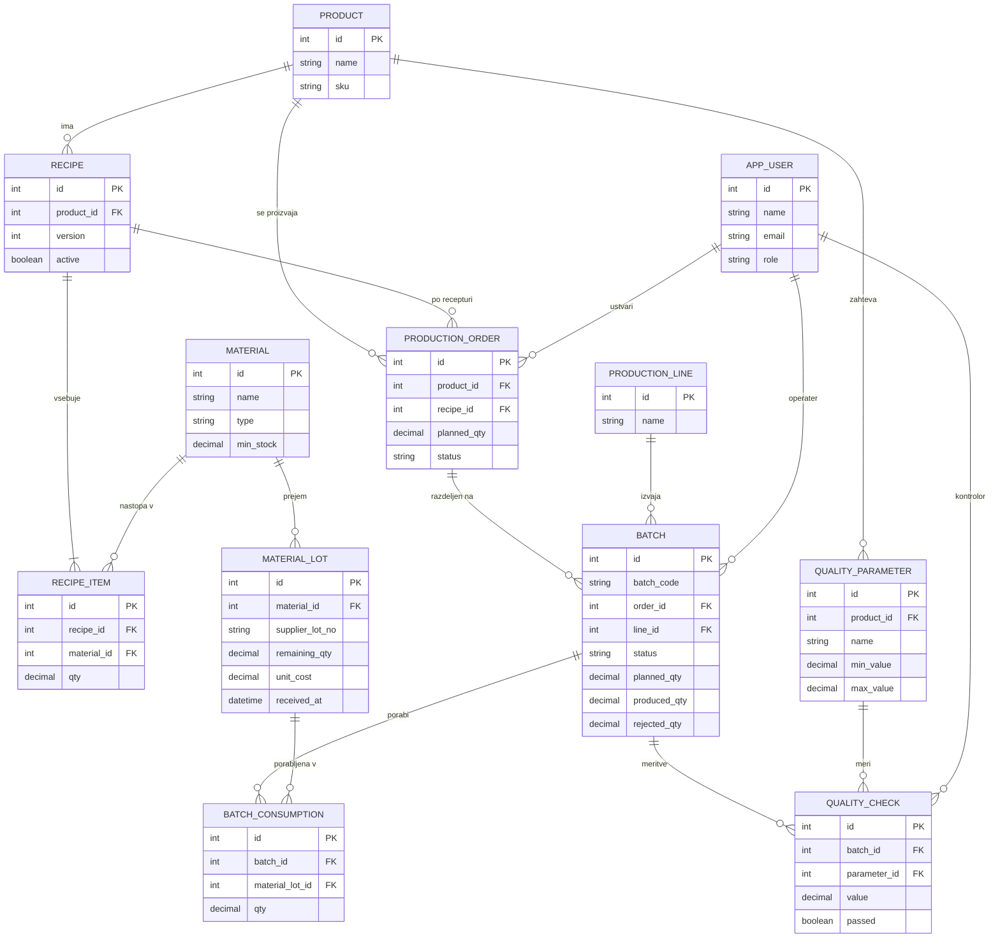

# 03 – Podatkovni model

Podatkovna baza je relacijska (**PostgreSQL**). Model je zasnovan tako, da omogoča sledljivost v obe smeri: šaržo povezujemo s serijami surovin prek vmesne tabele porabe (povezava M:N).

## 1. Entitete in glavna polja

### app_user
| Polje | Tip | Opomba |
|---|---|---|
| id | PK | |
| name | besedilo | |
| email | besedilo |  |
| password_hash | besedilo |  |
| role | enum | operator, quality, planner, warehouse, admin |
| active | boolean | |
| created_at | datum in čas | |

### product
| Polje | Tip | Opomba |
|---|---|---|
| id | PK | |
| name | besedilo | npr. »Jabolčni sok 1 L« |
| sku | besedilo | (Stock Keeping Unit) je unikatna oznaka izdelka, ki se uporablja za njegovo identifikacijo in upravljanje zalog. |
| unit | besedilo | npr. kos (steklenica) |

### recipe
Receptura izdelka. Ima verzije, zato sprememba ne vpliva na že izdelane šarže.

| Polje | Tip | Opomba |
|---|---|---|
| id | PK | |
| product_id | FK → product | |
| version | celo število | unikatna kombinacija (product_id, version) |
| output_qty | število | koliko enot nastane po eni izvedbi receptur |
| active | boolean | samo ena aktivna verzija na izdelek |

### recipe_item
| Polje | Tip | Opomba |
|---|---|---|
| id | PK | |
| recipe_id | FK → recipe | |
| material_id | FK → material | |
| qty | število | količina surovine na `output_qty` enot |

### material
Surovina ali embalaža.

| Polje | Tip | Opomba |
|---|---|---|
| id | PK | |
| name | besedilo | npr. »Sadni koncentrat«, »Zamašek 38 mm« |
| type | enum | ingredient, packaging |
| unit | besedilo | kg, L, kos |
| min_stock | število | prag za opozorilo |

### material_lot
Posamezen prejem (serija) surovine.

| Polje | Tip | Opomba |
|---|---|---|
| id | PK | |
| material_id | FK → material | |
| supplier | besedilo | |
| supplier_lot_no | besedilo | dobaviteljeva številka serije |
| received_qty | število | |
| remaining_qty | število | ne sme biti negativen |
| unit_cost | število | za izračun stroška |
| received_at | datum in čas | podlaga za FIFO |
| received_by | FK → app_user | |

### production_line
| Polje | Tip | Opomba |
|---|---|---|
| id | PK | |
| name | besedilo | npr. »Linija 1« |
| active | boolean | |

### production_order
| Polje | Tip | Opomba |
|---|---|---|
| id | PK | |
| product_id | FK → product | |
| recipe_id | FK → recipe | zamrznjena verzija ob nastanku naloga |
| planned_qty | število | |
| planned_date | datum | |
| status | enum | planned, in_progress, done, cancelled |
| created_by | FK → app_user | |

### batch (šarža)
Osrednja entiteta sistema.

| Polje | Tip | Opomba |
|---|---|---|
| id | PK | |
| batch_code | besedilo | unikaten, npr. `2026-10-05-L1-01` |
| order_id | FK → production_order | |
| line_id | FK → production_line | |
| operator_id | FK → app_user | |
| status | enum | in_production, awaiting_qc, released, rejected |
| planned_qty | število | količina, za katero je bila ob zagonu izračunana poraba surovin |
| produced_qty | število | |
| rejected_qty | število | izmet med polnjenjem |
| started_at / finished_at | datum in čas | |
| decided_by | FK → app_user | kontrolor, ki je odločil |
| decided_at | datum in čas | |
| decision_note | besedilo | obvezen razlog pri zavrnitvi |

### batch_consumption
Vmesna tabela, ki povezuje šaržo s serijami surovin.

| Polje | Tip | Opomba |
|---|---|---|
| id | PK | |
| batch_id | FK → batch | |
| material_lot_id | FK → material_lot | |
| qty | število | odpisana količina |

### quality_parameter
Zahtevani parametri in meje za izdelek.

| Polje | Tip | Opomba |
|---|---|---|
| id | PK | |
| product_id | FK → product | |
| name | besedilo | Brix*, pH, CO₂, nivo polnjenja |
| unit | besedilo | |
| min_value / max_value | število | dovoljeno območje |

*Brix (°Bx) je merska enota, ki pove, koliko gramov saharoze je v 100 gramih raztopine.

### quality_check
| Polje | Tip | Opomba |
|---|---|---|
| id | PK | |
| batch_id | FK → batch | |
| parameter_id | FK → quality_parameter | |
| value | število | izmerjena vrednost |
| passed | boolean | sistem izračuna iz mej |
| checked_by | FK → app_user | |
| checked_at | datum in čas | |

## 2. Povezave med entitetami

- **product 1 : N recipe**, **recipe 1 : N recipe_item**, **material 1 : N recipe_item** (receptura vsebuje več surovin).
- **material 1 : N material_lot** (surovina se prejema v več serijah).
- **product 1 : N production_order**; **production_order 1 : N batch** (en nalog se lahko izvede v več šaržah).
- **production_line 1 : N batch**.
- **batch N : M material_lot** prek **batch_consumption** (šarža porabi več serij, serija se uporabi v več šaržah). To je ključna povezava za sledljivost.
- **product 1 : N quality_parameter**; **batch 1 : N quality_check**; **quality_parameter 1 : N quality_check**.
- **app_user** je naveden kot operater, kontrolor, prejemnik in ustvarjalec v več tabelah.

## 3. Mermaid diagram (ER)

