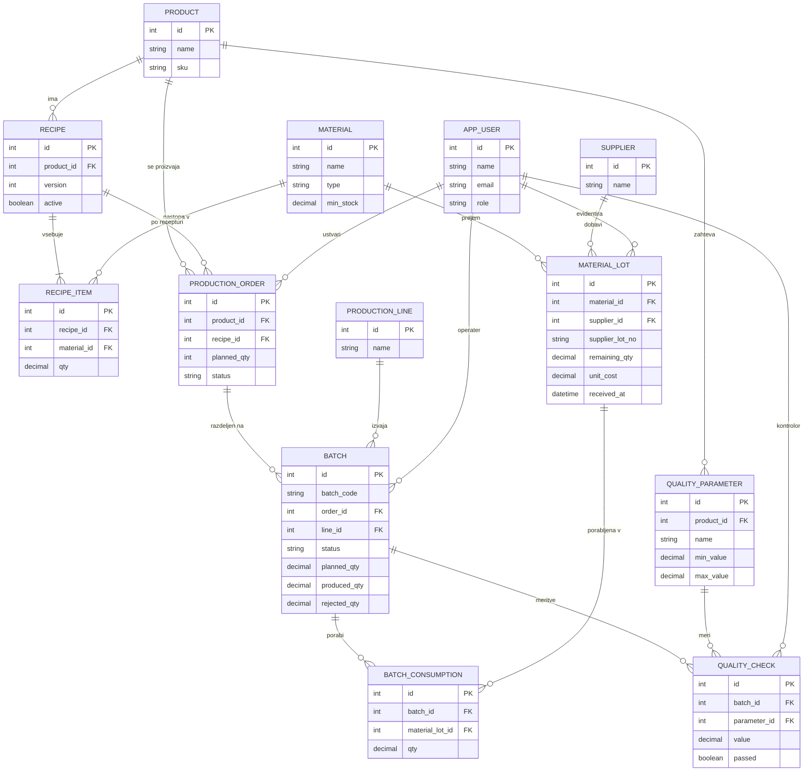

<!-- — tabele, polja, povezave in ER diagram. -->
# 03 – Podatkovni model

Podatkovna baza je relacijska (**PostgreSQL**). Model je zasnovan tako, da omogoča sledljivost v obe smeri: šaržo povezujemo s serijami surovin prek vmesne tabele porabe (povezava M:N).

## 1. Entitete in glavna polja

### app_user
| Polje | Tip | Opomba |
|---|---|---|
| id | PK | |
| name | besedilo | |
| email | besedilo |  |
| password_hash | besedilo |  |
| role | enum | operator, quality, planner, warehouse, admin |
| active | boolean | |
| created_at | datum in čas | |

### product
| Polje | Tip | Opomba |
|---|---|---|
| id | PK | |
| name | besedilo | npr. »Jabolčni sok 1 L« |
| sku | besedilo | (Stock Keeping Unit) je unikatna oznaka izdelka, ki se uporablja za njegovo identifikacijo in upravljanje zalog. |
| unit | besedilo | npr. kos (steklenica) |

### recipe
Receptura izdelka. Ima verzije, zato sprememba ne vpliva na že izdelane šarže.

| Polje | Tip | Opomba |
|---|---|---|
| id | PK | |
| product_id | FK → product | |
| version | celo število | unikatna kombinacija (product_id, version) |
| output_qty | numeric(12,3) | pozitivna količina enot, ki nastane po eni izvedbi recepture |
| active | boolean | privzeto false; delni enolični indeks dovoljuje največ eno aktivno verzijo na izdelek |

### recipe_item
| Polje | Tip | Opomba |
|---|---|---|
| id | PK | |
| recipe_id | FK → recipe | |
| material_id | FK → material | |
| qty | numeric(12,3) | pozitivna količina surovine na `output_qty` enot; surovina se v isti verziji ne ponovi |

### material
Surovina ali embalaža.

| Polje | Tip | Opomba |
|---|---|---|
| id | PK | |
| name | besedilo | npr. »Sadni koncentrat«, »Zamašek 38 mm« |
| type | enum | ingredient, packaging |
| unit | besedilo | kg, L, kos |
| min_stock | numeric(12,3) | nenegativen prag za opozorilo, privzeto 0 |

### supplier
Dobavitelj surovine ali embalaže. Ločen model omogoča enolično identifikacijo istega dobavitelja pri več prejemih, skladno z nalogo US-04/1.

| Polje | Tip | Opomba |
|---|---|---|
| id | PK | |
| name | besedilo | enolično ime dobavitelja, največ 120 znakov |

### material_lot
Posamezen prejem (serija) surovine.

| Polje | Tip | Opomba |
|---|---|---|
| id | PK | |
| material_id | FK → material | |
| supplier_id | FK → supplier | dobavitelj prejete serije |
| supplier_lot_no | besedilo | dobaviteljeva številka serije |
| received_qty | numeric(12,3) | večja od 0 |
| remaining_qty | numeric(12,3) | med 0 in received_qty |
| unit_cost | numeric(12,3) | nenegativna cena za izračun stroška |
| received_at | datum in čas s časovnim pasom | privzeto trenutni čas, podlaga za FIFO |
| received_by | FK → app_user | |

Kombinacija `material_id`, `supplier_id` in `supplier_lot_no` je enolična. Indeks `(material_id, received_at, id)` podpira poznejšo FIFO porabo; ID razreši enak čas prejema. Tuji ključi preprečujejo brisanje surovine, dobavitelja ali uporabnika, na katerega se sklicuje serija. Ob prejemu bo API nastavil `remaining_qty = received_qty` in `received_by` na prijavljenega skladiščnika (US-04/2).

### production_line
| Polje | Tip | Opomba |
|---|---|---|
| id | PK | |
| name | besedilo | enolično ime, npr. »Linija 1« |
| active | boolean | privzeto true |

### production_order
| Polje | Tip | Opomba |
|---|---|---|
| id | PK | |
| product_id | FK → product | |
| recipe_id | FK → recipe | zamrznjena verzija ob nastanku naloga |
| planned_qty | celo število | pozitivna načrtovana količina, največ 2147483647 |
| planned_date | datum | |
| status | enum | planned, in_progress, done, cancelled |
| created_by | FK → app_user | |

### batch (šarža)
Osrednja entiteta sistema.

| Polje | Tip | Opomba |
|---|---|---|
| id | PK | |
| batch_code | besedilo | unikaten, npr. `2026-10-05-L1-01` |
| order_id | FK → production_order | |
| line_id | FK → production_line | |
| production_date | datum | dan kode v časovnem pasu Europe/Ljubljana |
| sequence_no | celo število | pozitivna zaporedna številka za linijo in dan; trojica line_id, production_date, sequence_no je enolična |
| operator_id | FK → app_user | |
| status | enum | in_production, awaiting_qc, released, rejected |
| planned_qty | numeric(12,3) | pozitivna količina, za katero je bila ob zagonu izračunana poraba surovin |
| produced_qty | celo število | nenegativno, privzeto 0 |
| rejected_qty | celo število | nenegativen izmet, največ produced_qty, privzeto 0 |
| started_at / finished_at | datum in čas | |
| decided_by | FK → app_user | kontrolor, ki je odločil |
| decided_at | datum in čas | |
| decision_note | besedilo | obvezen razlog pri zavrnitvi |

### batch_consumption
Vmesna tabela, ki povezuje šaržo s serijami surovin.

| Polje | Tip | Opomba |
|---|---|---|
| id | PK | |
| batch_id | FK → batch | |
| material_lot_id | FK → material_lot | |
| qty | numeric(12,3) | pozitivna odpisana količina; par batch_id, material_lot_id je enoličen |

Zagon in FIFO poraba se izvedeta v eni transakciji. Preverjanje in odpis uporabljata iste količine. Če formula za izbrano količino šarže zahteva več kot tri decimalna mesta sestavine, se zagon zavrne, da ne pride do tihega zaokroževanja ali neskladja s shranjeno zalogo. Podrobnosti zagonov so v ADR 0004 in implementacijskem poročilu.

### quality_parameter
Zahtevani parametri in meje za izdelek.

| Polje | Tip | Opomba |
|---|---|---|
| id | PK | |
| product_id | FK → product | |
| name | besedilo | Brix*, pH, CO₂, nivo polnjenja |
| unit | besedilo | |
| min_value / max_value | decimal(12,3) | vključujoče dovoljeno območje, min_value ≤ max_value |

*Brix (°Bx) je merska enota, ki pove, koliko gramov saharoze je v 100 gramih raztopine.

### quality_check
| Polje | Tip | Opomba |
|---|---|---|
| id | PK | |
| batch_id | FK → batch | |
| parameter_id | FK → quality_parameter | |
| value | decimal(12,3) | končna izmerjena vrednost, brez tihega zaokroževanja v API |
| passed | boolean | sistem izračuna iz mej |
| checked_by | FK → app_user | |
| checked_at | datum in čas s časovnim pasom | |

Ime parametra je enolično znotraj izdelka. Vsak ponovni vnos meritve ustvari nov zapis; za zadnjo meritev velja največji `checked_at`, ob izenačenju pa največji `id`. Pregled šarže vrne parametre njenega izdelka z zadnjo meritvijo ali `null` ter zgodovino meritev. API dovoli vnos samo kontrolorju za šaržo `awaiting_qc`; rezultat `passed`, kontrolor in čas se določijo na strežniku.

## 2. Povezave med entitetami

- **product 1 : N recipe**, **recipe 1 : N recipe_item**, **material 1 : N recipe_item** (receptura vsebuje več surovin).
- **material 1 : N material_lot** (surovina se prejema v več serijah).
- **supplier 1 : N material_lot** (dobavitelj dobavi več serij).
- **product 1 : N production_order**; **production_order 1 : N batch** (en nalog se lahko izvede v več šaržah).
- **production_line 1 : N batch**.
- **batch N : M material_lot** prek **batch_consumption** (šarža porabi več serij, serija se uporabi v več šaržah). To je ključna povezava za sledljivost.
- **product 1 : N quality_parameter**; **batch 1 : N quality_check**; **quality_parameter 1 : N quality_check**.
- **app_user** je naveden kot operater, kontrolor, prejemnik in ustvarjalec v več tabelah.

## 3. Mermaid diagram (ER)

