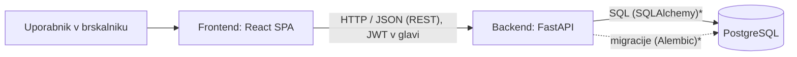

# 04 – Arhitektura in tehnološki sklad

## 1. Arhitektura

Rešitev ima klasično troplastno zasnovo z ločenim frontendom in backendom:

- **Frontend:** enostranska aplikacija (SPA - Single-Page Application), ki prikazuje uporabniški vmesnik.
- **Backend:** REST API, ki vsebuje vso poslovno logiko in preverjanje pravic.
- **Podatkovna baza:** relacijska baza, do katere dostopa samo backend.

### Diagram


*SQLAlchemy (Python) omogoča delo s podatki in tabelami v podatkovni bazi.

*Alembic (Python) omogoča nadzorovano spreminjanje strukture podatkovne baze skozi čas.

Vse tri komponente se lokalno zaženejo kot ločeni Docker kontejnerji.

### Glavni deli sistema

| Del | Naloga |
|---|---|
| **Frontend (SPA)** | Prijava, obrazci za vnos, seznami šarž in nalogov, nadzorna plošča. Stanje strežnika pridobiva prek API-ja. |
| **Backend (API)** | Avtentikacija, preverjanje vlog, poslovna pravila (zagon šarže, sprostitev, FIFO poraba), validacija vnosov, dostop do baze. |
| **Podatkovna baza** | Trajno shranjevanje podatkov; transakcije in omejitve zagotavljajo celovitost. |

### Komunikacija med deli

- Frontend in backend komunicirata prek **REST API-ja** v obliki **JSON** po protokolu HTTP.
- Vsak zahtevek (razen prijave) vsebuje glavo `Authorization: Bearer <JWT>` (JWT žeton za preverjanje pristnosti uporabnika.).
- Backend samodejno ustvari **OpenAPI dokumentacijo** (Swagger UI)
- Backend dovoli zahtevke samo z izvora frontenda (nastavitev CORS - s katerih spletnih naslovov lahko frontend dostopa do backenda.).
- Backend je edini, ki komunicira z bazo; frontend do baze nima neposrednega dostopa.

Primeri pomembnejših končnih točk (načrt):

| Metoda in pot | Namen | Vloga |
|---|---|---|
| `POST /auth/login` | Prijava, vrne JWT | vsi |
| `POST /material-lots` | Prejem surovine | skladiščnik |
| `POST /orders` | Nov proizvodni nalog | planer |
| `POST /orders/{id}/batches` | Zagon šarže (preverjanje zalog, poraba) | operater |
| `POST /batches/{id}/finish` | Konec polnjenja, v kontrolo | operater |
| `POST /batches/{id}/checks` | Vnos meritev | kontrolor |
| `POST /batches/{id}/release` | Sprostitev šarže | kontrolor |
| `POST /batches/{id}/reject` | Zavrnitev z razlogom | kontrolor |
| `GET /traceability/batch/{id}` | Sledljivost nazaj | planer, kontrolor |
| `GET /traceability/lot/{id}` | Sledljivost naprej | planer, kontrolor |

### Podatkovna baza

PostgreSQL, shema je opisana v datoteki `03-podatkovni-model.md`. Shemo upravljamo z migracijami (Alembic), začetne podatke (šifranti, testni uporabniki) nalaga skripta za seed.

### Avtentikacija in upravljanje uporabnikov

- Uporabnike ustvari administrator; samostojne registracije ni (sistem je interni).
- Gesla se shranijo kot zgoščena vrednost (bcrypt ali argon2).
- Ob prijavi backend izda **JWT** z identifikatorjem uporabnika in vlogo ter kratko življenjsko dobo.
- Vsaka končna točka ima **odvisnost za preverjanje vloge** (npr. samo `quality` lahko sprosti šaržo).

### Način lokalnega zagona

Cilj je en ukaz: `docker compose up --build`. Docker Compose zažene:

| Servis | Slika / vir | 
|---|---|
| `db` | `postgres` | 
| `backend` | lasten Dockerfile (Python) | 
| `frontend` | lasten Dockerfile (Node, Vite) | 

Konfiguracija (povezava do baze) je v datoteki `.env`, v repozitoriju primer `.env.example`. Ob prvem zagonu backend izvede migracije in po želji naloži testne podatke.

### Predvidena struktura repozitorija

```
pijacai/
  docker-compose.yml
  .env.example
  backend/
    app/
      api/          # poti (routers)
      services/     # poslovna logika (zagon šarže, sprostitev, sledljivost)
      models/       # SQLAlchemy modeli
      schemas/      # Pydantic sheme
      core/         # nastavitve, varnost
    alembic/        # migracije
    tests/
  frontend/
    src/
      pages/ components/ api/
  docs/
```

## 2. Tehnološki sklad

| Področje | Izbira | Zakaj (na kratko) |
|---|---|---|
| Frontend | **React** (Vite, TypeScript) | Komponentni pristop, hiter razvoj, velik ekosistem |
| Grafi na nadzorni plošči | Recharts | Preprosta integracija z Reactom |
| Backend | **FastAPI** (Python) | Hiter razvoj, vgrajena validacija, samodejna OpenAPI dokumentacija |
| ORM (Object-Relational Mapping) in migracije | SQLAlchemy, Alembic | Zrel standard za relacijske baze v Pythonu |
| Podatkovna baza | **PostgreSQL** | Močne transakcije in omejitve, primerna za povezane podatke |
| Avtentikacija | JWT z vlogami, zgoščevanje gesel (bcrypt/argon2) | Brez stanja na strežniku|
| Lokalni razvoj | Docker Compose | Enak zagon na vseh računalnikih |
| Testiranje | pytest (backend), preverjanje poslovnih pravil | Ključna so pravila zagona in sprostitve šarže |
| Orodja | Git, Swagger UI | Verzioniranje in preizkušanje API-ja |

## 3. Arhitekturne odločitve

**Ločen frontend in backend (SPA + REST API), ne monolit.**
Naloga zahteva klasično ločitev, vendar ima pristop tudi praktične prednosti: API je neodvisen od vmesnika, kar omogoča kasnejšo mobilno obliko za operaterje (PWA) ali drug odjemalec. Cena je dodatna kompleksnost (CORS, avtentikacija prek API-ja), ki je obvladljiva.

**PostgreSQL namesto dokumentne baze (npr. MongoDB).**
Podatki so močno povezani (šarža – poraba – serija surovine – dobavitelj) in sledljivost temelji na stikih med tabelami. Poleg tega potrebujemo **transakcije**: zagon šarže spremeni več tabel hkrati in mora biti vse ali nič. Relacijski model z tujimi ključi in omejitvami to naravno podpira.

**Povezava več-na-več prek tabele `batch_consumption`.**
Če bi surovine shranjevali kot seznam znotraj šarže, sledljivost naprej (katere šarže so prizadete) ne bi bila učinkovita. Ločena tabela omogoča poizvedbi v obe smeri in zapis, koliko točno je bilo porabljeno iz katere serije.

**Poslovna logika v backendu (servisni sloj), ne v frontendu.**
Pravila, kot sta »šarže ni mogoče sprostiti brez ustreznih meritev« in »zagon šarže odpiše zaloge«, morajo veljati ne glede na odjemalca. Ločen servisni sloj jih naredi tudi preprosto testljive.

**FIFO odpis surovin.**
Pri hrani in pijači je smiselno najprej porabiti starejše serije. Pravilo je enostavno in dobro razložljivo; zaloge tako ostajajo sveže.

**Verzioniranje receptur in zamrznitev ob nalogu.**
Če bi se receptura spremenila, bi stare šarže izgubile pomen. S pripetjem verzije na nalog zgodovina ostane pravilna.

**JWT namesto sej na strežniku.**
Backend ostane brez stanja, kar poenostavi ločitev od frontenda in kasnejše skaliranje. Kompromis: preklic žetona je težji, zato je življenjska doba kratka.

**FastAPI namesto Django ali Express.**
FastAPI nudi vgrajeno validacijo vhodov in samodejno dokumentacijo API-ja, kar je koristno pri razlagi rešitve razvijalcu, ki pri zasnovi ni sodeloval. Django bi prinesel več vgrajenega (admin), vendar je bolj usmerjen v strežniško upodabljanje strani.

**Docker Compose za lokalni zagon.**
Zmanjša težave z različnimi okolji; razvijalec potrebuje samo Docker.

## 4. Možnosti nadaljnjega razvoja

Arhitektura omogoča razširitve brez večjih posegov:
- dodatne poti API-ja in strani za nove funkcionalnosti (odpoklic, OEE - Overall Equipment Effectiveness),
- WebSocket kanal za sprotne posodobitve nadzorne plošče,
- ločen izvoz za poročila (PDF, Excel),
- podpora večim lokacijam proizvodnje
