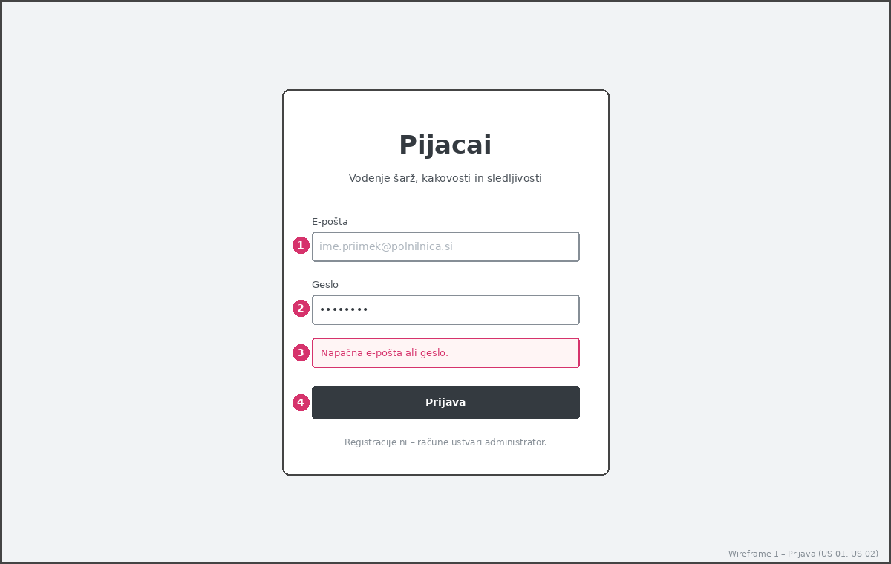
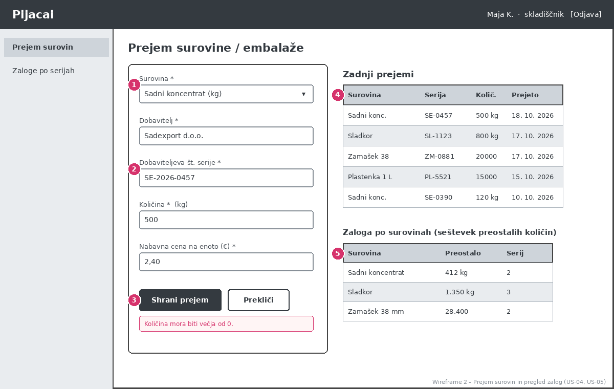
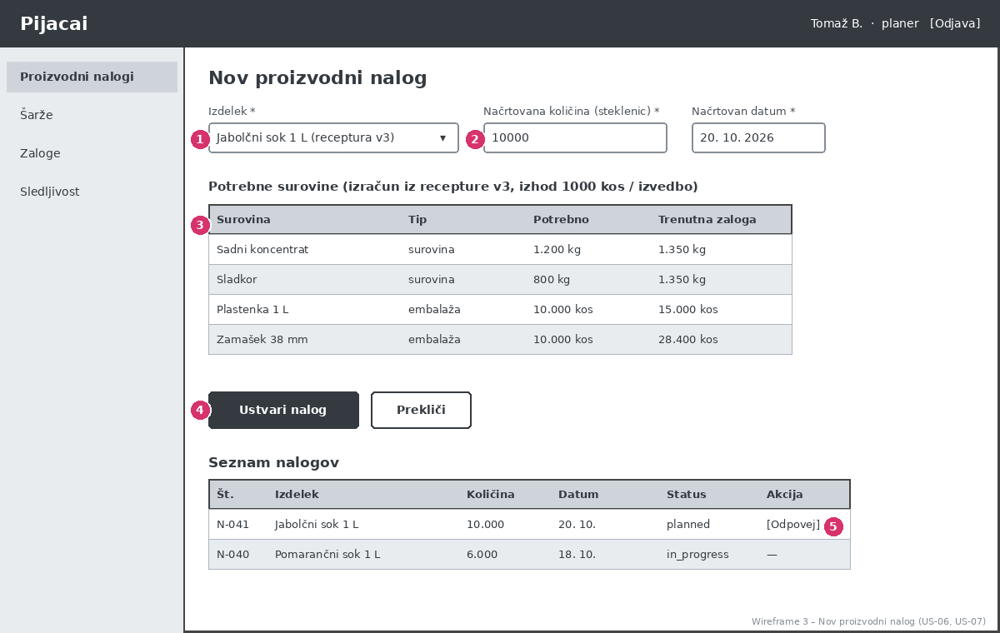
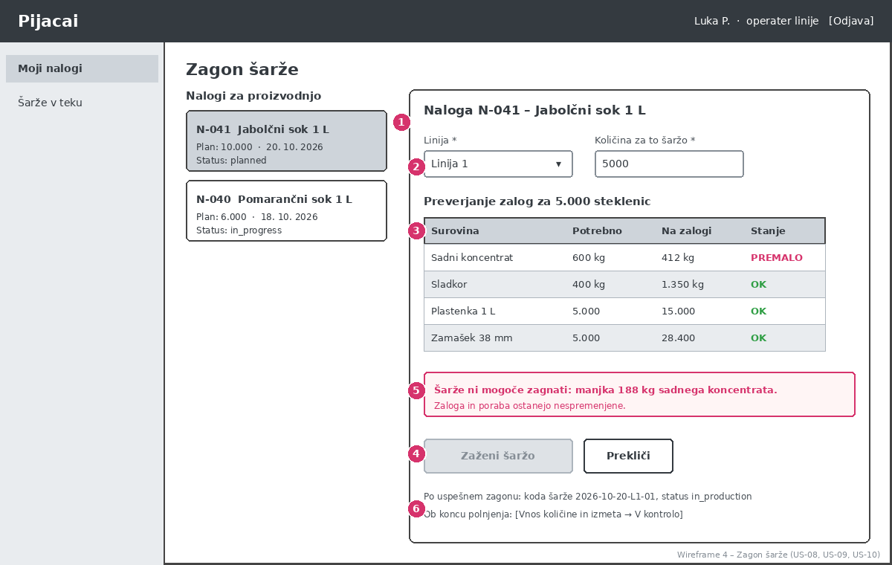
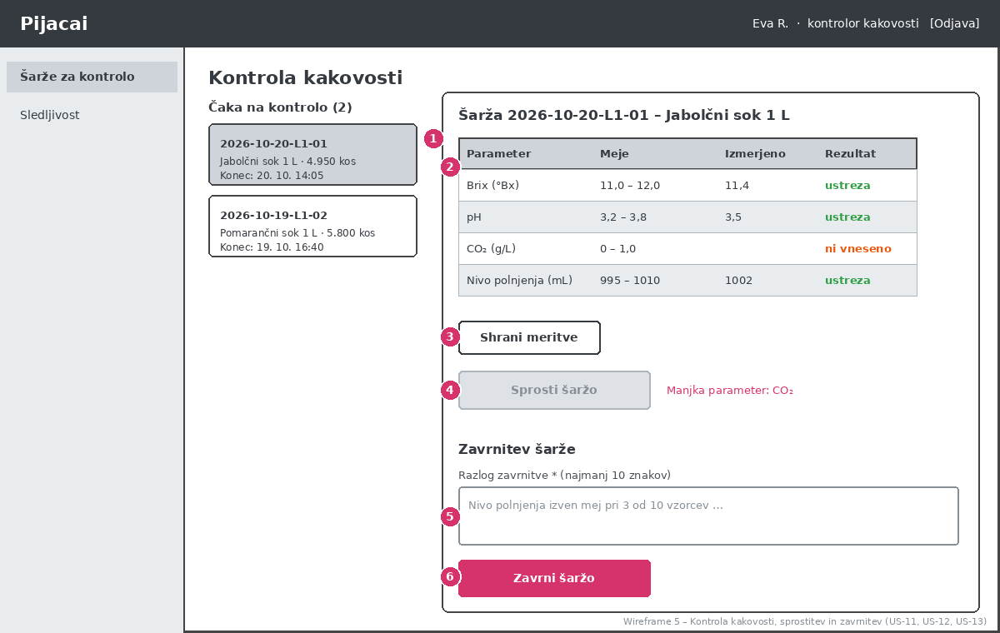
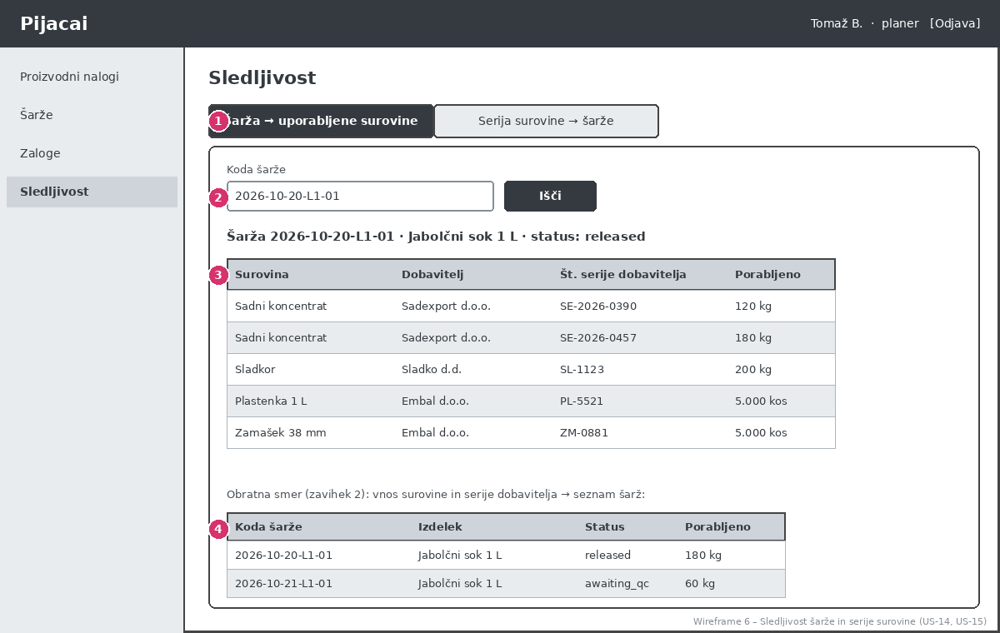

# 06 – Wireframes

Wireframe-i prikazujejo osnoven izgled MVP aplikacije **Pijacai**. Vsi zasloni imajo enako zasnovo: zgoraj vrstica z imenom aplikacije in prijavljenim uporabnikom, na levi meni, ki prikazuje samo strani za vlogo prijavljenega uporabnika (US-02), v sredini pa vsebina. Rdeče številke na slikah so oznake elementov, ki so opisani pod vsako sliko.

Slike so v mapi `wireframes/`. Podatki na slikah so izmišljeni primeri.

| # | Zaslon | Vloga | Povezane zgodbe |
|---|---|---|---|
| 1 | Prijava | vse | US-01, US-02 |
| 2 | Prejem surovin in pregled zalog | skladiščnik | US-04, US-05 |
| 3 | Nov proizvodni nalog | planer | US-06, US-07 |
| 4 | Zagon šarže | operater linije | US-08, US-09, US-10 |
| 5 | Kontrola kakovosti | kontrolor kakovosti | US-11, US-12, US-13 |
| 6 | Sledljivost | planer, kontrolor kakovosti | US-14, US-15 |

---

## Wireframe 1 – Prijava

Začetni zaslon, ki ga vidi vsak uporabnik pred prijavo. Registracije ni, ker račune ustvari administrator.

1. Polje za e-pošto.
2. Polje za geslo (znaki so skriti).
3. Sporočilo o napaki ob napačnih podatkih. Ne razkrije, ali je napačna e-pošta ali geslo (US-01).
4. Gumb »Prijava«. Po uspešni prijavi uporabnik pride na začetno stran svoje vloge.

---

## Wireframe 2 – Prejem surovin in pregled zalog

Zaslon skladiščnika. Na levi je obrazec za vnos prejema nove serije, na desni zadnji prejemi in zaloga po surovinah.

1. Izbor surovine iz šifranta; naslednja polja so dobavitelj, dobaviteljeva številka serije, količina in nabavna cena.
2. Polje za količino s sporočilom o napaki, če vrednost ni večja od 0 (US-04).
3. Gumba »Shrani prejem« in »Prekliči«.
4. Tabela zadnjih prejemov (surovina, serija, količina, datum).
5. Zaloga po surovinah: vsota preostalih količin in število serij (US-05).

---

## Wireframe 3 – Nov proizvodni nalog

Zaslon planerja za ustvarjanje naloga in pregled obstoječih nalogov.

1. Izbor izdelka. Ob izbiri se prikaže številka aktivne verzije receptur (npr. v3).
2. Vnos načrtovane količine; poleg je načrtovan datum.
3. Tabela potrebnih surovin, izračunana iz receptur, s prikazom trenutne zaloge, da planer pred potrditvijo vidi, ali bo surovin dovolj (US-06).
4. Gumb »Ustvari nalog« (status naloga postane `planned`).
5. Seznam nalogov z gumbom »Odpovej«, ki je na voljo samo za naloge v stanju `planned` (US-07).

---

## Wireframe 4 – Zagon šarže

Zaslon operaterja linije. Na sliki je prikazan primer, v katerem zaloga ne zadošča, zato zagon ni mogoč.

1. Seznam nalogov, ki jih je mogoče izvesti (`planned`, `in_progress`); izbran nalog je poudarjen.
2. Izbor linije in količine za šaržo.
3. Preverjanje zalog po sestavinah: potrebno, na zalogi in stanje (OK / PREMALO) (US-08).
4. Gumb »Zaženi šaržo«, ki je onemogočen, dokler katera koli sestavina manjka.
5. Opozorilo z manjkajočo količino. Zaloga in poraba ostanejo nespremenjeni.
6. Opomba o nadaljevanju: po uspešnem zagonu šarža dobi kodo in status `in_production`, odpis surovin pa poteka po FIFO (US-09); ob koncu polnjenja operater vnese količino in izmet ter šaržo preda v kontrolo (US-10).

---

## Wireframe 5 – Kontrola kakovosti

Zaslon kontrolorja kakovosti za vnos meritev ter sprostitev ali zavrnitev šarže.

1. Seznam šarž v stanju `awaiting_qc`; izbrana šarža je poudarjena.
2. Tabela parametrov izdelka z mejami, izmerjeno vrednostjo in rezultatom. Ustrezne vrednosti so zelene, manjkajoče označene (US-11).
3. Gumb »Shrani meritve«.
4. Gumb »Sprosti šaržo« je onemogočen, dokler niso vneseni vsi parametri in vsi ne ustrezajo mejam; ob njem je razlog (US-12).
5. Polje za razlog zavrnitve, obvezno z najmanj 10 znaki.
6. Gumb »Zavrni šaržo« (US-13).

---

## Wireframe 6 – Sledljivost

Zaslon planerja ali kontrolorja za sledljivost v obe smeri.

1. Dva zavihka: »Šarža → uporabljene surovine« (nazaj) in »Serija surovine → šarže« (naprej).
2. Iskanje po kodi šarže.
3. Rezultat: izdelek in status šarže ter tabela uporabljenih serij s surovino, dobaviteljem, dobaviteljevo številko serije in porabljeno količino (US-14).
4. Primer rezultata v obratni smeri (zavihek 2): seznam šarž, v katerih je bila izbrana serija uporabljena, s statusom in količino (US-15).
